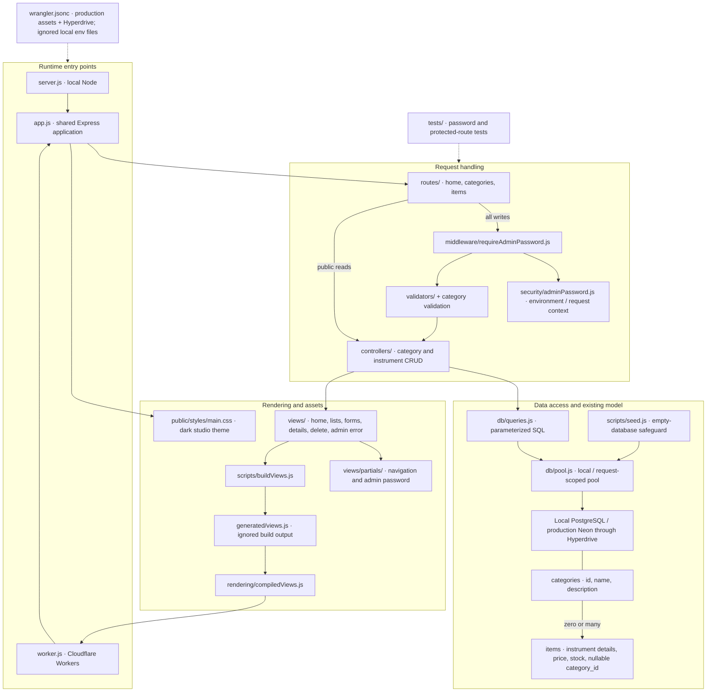
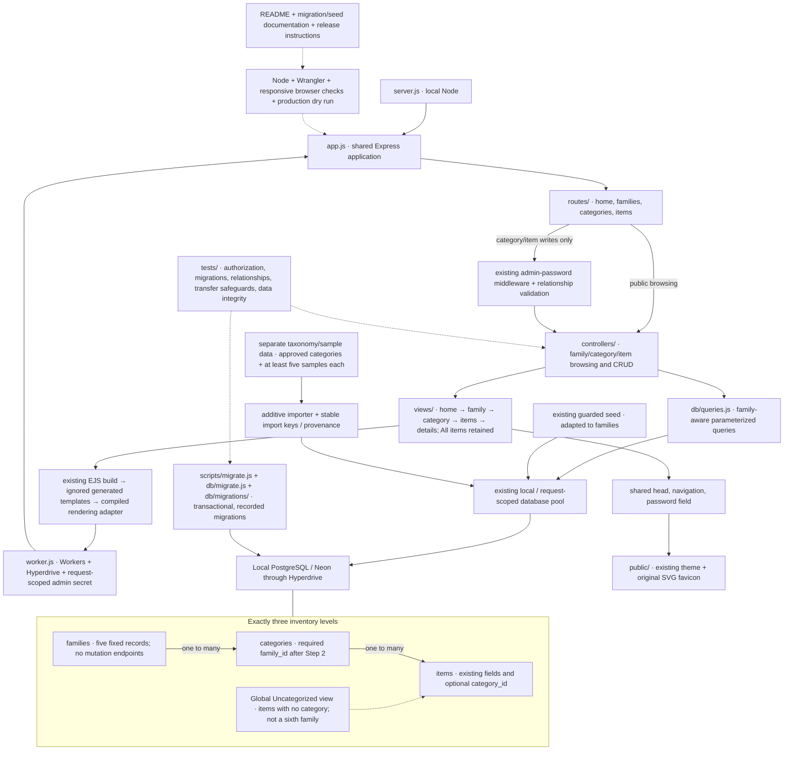

# Project structure: before and planned after

The first diagram records the working application at baseline commit `a33c5e2`, before the instrument-family reorganization. The second is the approved final target, not a claim that all four steps are implemented. Both diagrams use the existing Express/EJS/PostgreSQL architecture.

## Before the hierarchy changes

## Approved final target after all four steps

The planned importer filenames and provenance storage will be finalized in Step 3. No additional item-category table, user-account system, or framework is planned. Production migration and deployment require separate approval; pushing this feature branch does not authorize either action.
